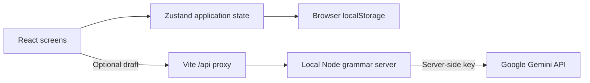

# OpenTeens

**Meet through shared interests. Practise English through conversation.**

OpenTeens is an educational web-app prototype exploring how teenagers could find conversation partners, exchange cultures, and practise English in a less formal setting. It combines interest-based discovery, friend requests, a chat interface, and optional AI grammar feedback.

**Current stage:** a working browser-local demonstration. Profiles in the demo are fictional, its initial conversation is a labelled sample, and messages do not travel between devices. The project demonstrates the interaction and application logic; it does not establish a live user community or measured language-learning outcomes.

## Why this project exists

Finding someone to practise a language with can be harder than finding another language exercise. The idea behind OpenTeens is to give people something they already want to discuss—music, books, films, or other shared interests—and make English practice part of that conversation.

The design explores three questions:

- Can shared interests give learners a more natural starting point for conversation?
- Can grammar feedback explain a correction while leaving the writer in control of what they send?
- What privacy, moderation, and consent features would be needed before opening a service like this to real teenagers?

These are design goals, not findings from a user study.

## Try it locally

Use **Node.js 24 or newer** and npm.

```sh
git clone https://github.com/beibarysertaiuly-ux/openteen.git
cd openteen
npm ci
npm run dev
```

Open **http://127.0.0.1:5173** and select **Explore the demo**. No registration, API key, or location permission is needed for the core walkthrough.

### A five-minute walkthrough

1. Start as **Alex**. Discover shows Jamie before Robin because Jamie shares more of Alex's interests. Sam is already connected so the sample chat can be inspected immediately.
2. Send Jamie a friend request using the heart button. Use **View as → Jamie** in the prototype banner and accept Alex's request in the notification or **Requests** tab.
3. Open the chat with Alex and send a message. Switch back to Alex, open Jamie's chat, and see the same message from the recipient's perspective. Both roles run in this browser; no remote user is involved.
4. Refresh: local profiles, requests, conversations, and preferences persist. Try a reaction by holding a message, then switch roles to see it.
5. Block a connected profile from its chat menu. The conversation becomes unavailable from either side until the blocking account unblocks it in Settings. Reports are saved locally and are not delivered to a review team.

**Reset demo** restores the fictional workspace after confirmation. It retains custom test accounts and conversations unrelated to the demo. Local test sign-up and onboarding are also available; use fictional details and a disposable password. These forms do not provide secure authentication.

## What is implemented

| Area | Current behavior | Boundary |
| --- | --- | --- |
| Discovery | Profiles ordered by the count of shared interests; self, connected, blocked, hidden, and already-requested profiles excluded | Deterministic ranking, not an AI recommender; no nationality-based inference of fluency |
| Connections | Requests, acceptance, and decline; connections visible to both participants | All records belong to one browser-local workspace |
| Text chat | Persistent conversations, sender/recipient views, and emoji reactions | No network delivery, WebSockets, or push notifications |
| Grammar feedback | Optional Gemini integration; correction and explanation; writer can send the suggestion or the original | Requires a server-side key and provider access; suggestions may be wrong |
| Word lookup | Tap a supported word to see its Spanish equivalent | Small fixed dictionary; not AI or full-message translation |
| Profiles | Test sign-up, onboarding, five interests, profile image, display-name editing, light/dark themes | Local data and demonstration validation; no identity verification |
| Safety interactions | Blocking, locally stored reports, phrase filtering, and simulated temporary restrictions | Rule-based demonstrations, not comprehensive moderation or a staffed safeguarding system |
| Voice notes | Browser microphone recording, capped at approximately one minute, stored locally | Experimental; microphone permission and storage capacity required; not visually or device tested in the latest audit |

Interest spelling aliases and the phrase filter are ordinary rules in `src/utils/mockData.js`. Only the optional grammar feature calls an AI model. The app does not train a model.

## Optional AI grammar feedback

The core demo works without AI. To try real grammar suggestions:

1. Copy `.env.example` to `.env` and set `GEMINI_API_KEY` to your own Google Gemini API key. Keep `.env` private.
2. In a second terminal, run `npm run server`. Keep `npm run dev` running in the first terminal.
3. In Settings, enable **AI Grammar Assist**, then send a short draft in a connected chat.

The browser sends the draft to `/api/grammar`; Vite forwards it to the loopback-only Node server, which contacts Google's [generateContent API](https://ai.google.dev/api/generate-content). The key stays on the server. The default model is `gemini-2.5-flash`; `GEMINI_MODEL` can select another model available to your account.

Enabling this feature sends draft text to Google. Use sample text; access, quotas, provider terms, and charges depend on your Google account. Missing configuration, timeouts, and invalid responses produce an explicit unavailable message with the option to send the original. There is no pretend AI fallback. Live model output has not been verified in the latest audit because no key was supplied.

The local server is a development helper. It is not a production API: public hosting would require authentication, abuse controls, rate limits, and a deliberate data-handling policy. `npm run preview` previews the static build only; it does not configure an AI proxy.

## Architecture



```text
src/components/    Navigation, notifications, and prototype/demo banner
src/pages/         Discovery, requests, chat, profile, onboarding, settings
src/store/         Per-account views, connections, conversations, persistence
src/utils/         Fictional demo data, deterministic rules, grammar client
server/            Optional local grammar endpoint
test/              Account-flow and grammar-endpoint regression tests
docs/              Project history and verification record
```

Built with React, React Router, Zustand, Framer Motion, Tailwind CSS, Vite, and Node.js. Fictional profile avatars are generated SVG initials with no external photo dependency.

## Verification

```sh
npm test
npm run build
npm audit
```

The 30 October 2026 review passed the automated tests and production build, and npm reported zero known dependency vulnerabilities at the time of the check. These checks do not establish production security, educational effectiveness, or cross-device behavior. Visual browser testing and live Gemini output remain unverified. See the [verification record](docs/VERIFICATION.md) for exact scope and a manual checklist.

GitHub Actions is configured to run installation, tests, and build on pushes and pull requests.

## Project history and contribution scope

This repository preserves the original prototype upload and a separately dated maintenance pass. The original project was developed collaboratively with AI coding assistance. Beibarys describes his focus as interface design and AI-related features, and his collaborator's focus as matching and other mechanics. The original single-upload history does not independently establish that division of authorship.

The **30 October 2026 maintenance pass used Codex assistance** to improve reproducibility, repair state flows, move AI credentials out of browser code, add a labelled demo and regression tests, and correct documentation. The current demo and these repairs date to that pass. See [project history](docs/PROJECT_HISTORY.md).

## Next development steps

Before real users could join, the project would need secure server-side accounts, a shared database and delivery service, appropriate consent and age-assurance processes, a threat model, comprehensive moderation with human escalation, privacy/deletion controls, and usability testing. Assessing English-learning value would require a separate study.

The current prototype is useful for demonstrating and discussing the proposed user journey and implementation decisions. It is not ready to operate as a public social network for minors.
